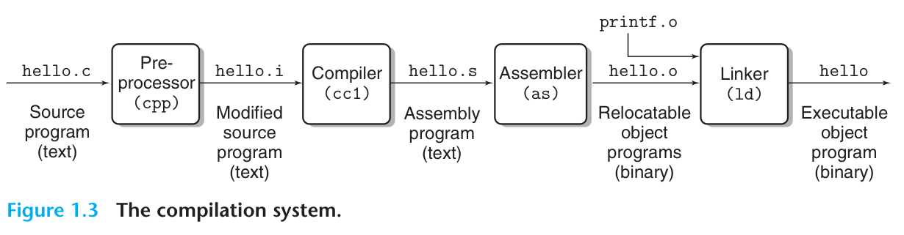
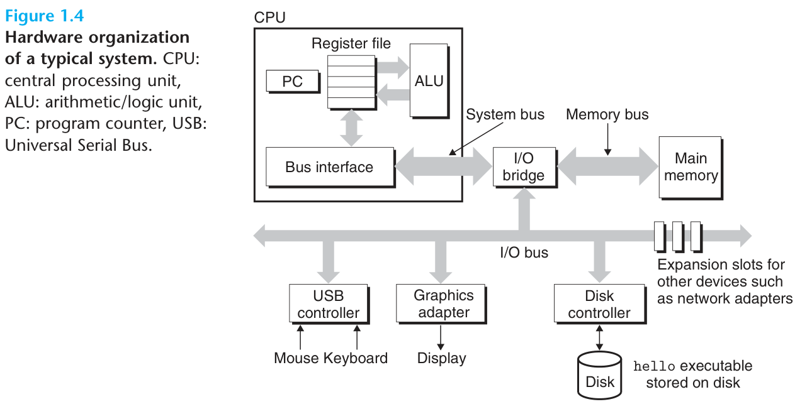
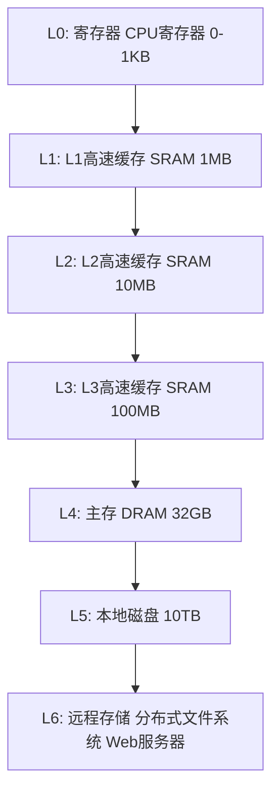
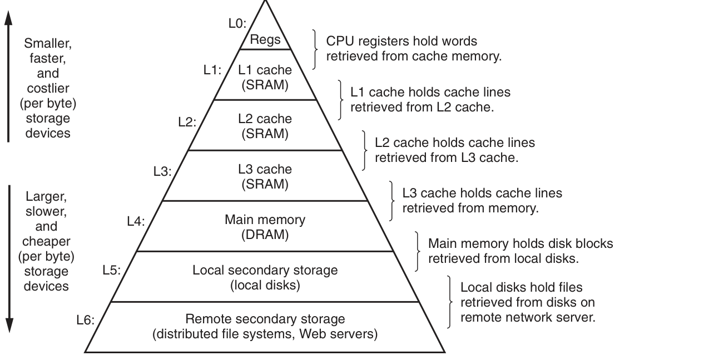
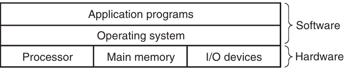
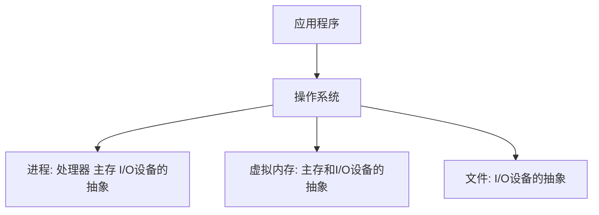
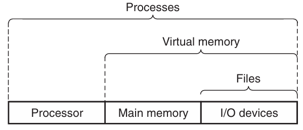
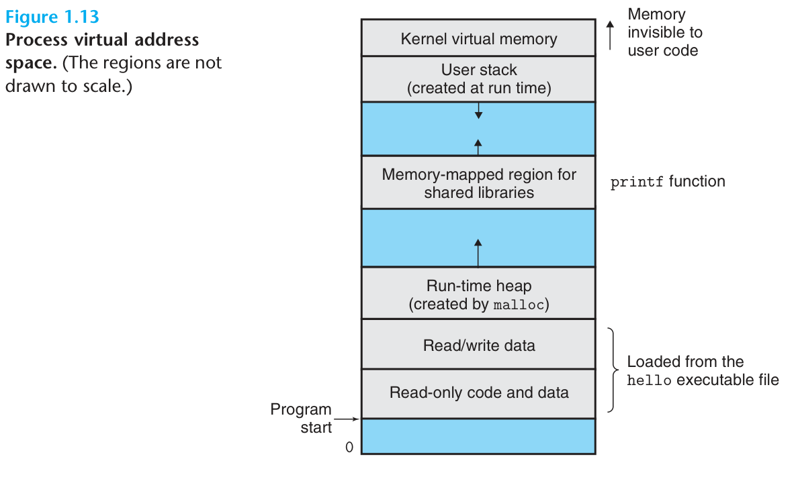
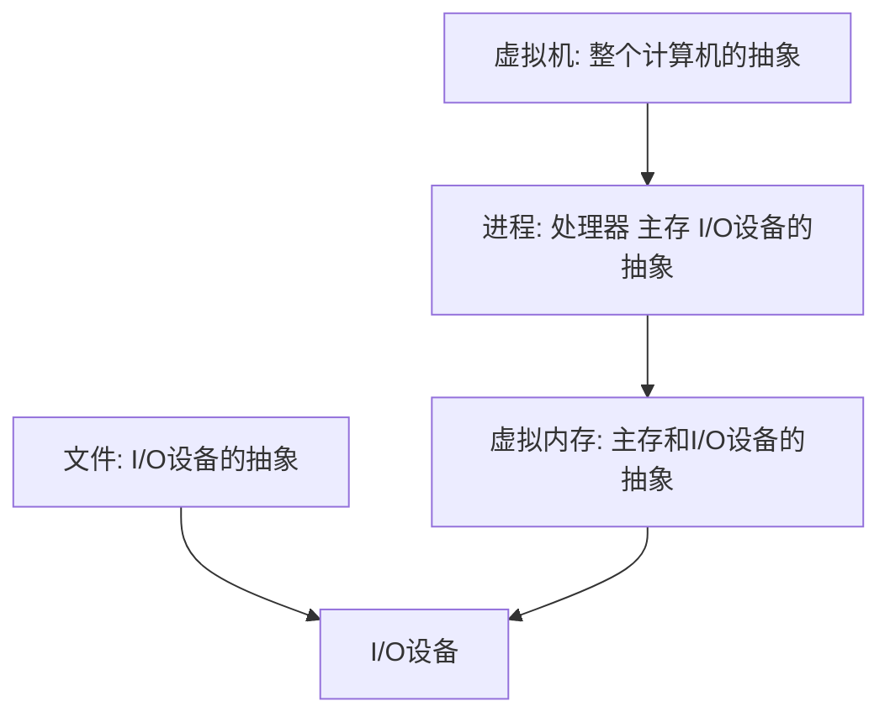

## 1.1 信息就是位 + 上下文

hello.c 的生命周期从一个源文件开始，它就是一个**位（bit）序列**：

```c
#include <stdio.h>

int main()
{
    printf("hello, world\n");
    return 0;
}
```

- 源文件本质是字节序列，每个字节是一个 8 位的位串。如 `#` 的 ASCII（American Standard Code for Information Interchange，美国信息交换标准代码）码是整数 35，写成二进制就是 `00100011`。
- 只由 ASCII 字符构成的文件称为**文本文件（text file）**，其他所有文件都称为**二进制文件（binary file）**。
- 系统中一切信息——磁盘文件、内存中的程序与数据、网络上传送的数据——都是一串位。**区分不同数据对象的唯一方法，是我们读到这些数据时的上下文（context）**：同样的字节序列，在不同上下文中可以是一个整数、字符串或机器指令。

## 1.2 程序被其他程序翻译成不同的格式

C 语言是**高级语言**，它的语句要先被翻译成机器能懂的指令序列（**机器语言**），打包成**可执行目标文件（executable object file）**才能运行。GCC（GNU Compiler Collection，GNU 编译器集合）驱动的翻译分四步（原书 Figure 1.3 的编译系统全景）：



- **预处理阶段（preprocessing）**：处理 `#` 开头的命令，`#include <stdio.h>` 把头文件内容直接插入程序文本，得到 `hello.i`。
- **编译阶段（compilation）**：将 `hello.i` 翻译成汇编语言程序 `hello.s`，其中每条语句描述一条低级机器指令。汇编是不同高级语言的**公共出口**——C 编译器和 Fortran 编译器输出的都是同一种汇编语言。
- **汇编阶段（assembly）**：将 `.s` 翻译成机器指令，打包成**可重定位目标文件（relocatable object file）** `hello.o`。
- **链接阶段（linking）**：hello 调用的 `printf` 函数在单独的、预编译好的目标文件 `printf.o`（标准 C 库的一部分）里，链接器把它和 `hello.o` 合并，得到可执行文件 `hello`。

平时一条命令搞定整个翻译流程：

```bash
linux> gcc -o hello hello.c
```

想观察每个阶段的产物，可用 gcc 的分步选项（-E 只预处理、-S 到汇编、-c 到目标文件，最后的链接不再需要专门选项）：

```bash
gcc -E hello.c -o hello.i   # 预处理: 展开头文件与宏, 产物是文本
gcc -S hello.i -o hello.s   # 编译: .i 翻译成汇编文本
gcc -c hello.s -o hello.o   # 汇编: 汇编翻译成机器指令, 产物是二进制的 .o
gcc hello.o -o hello        # 链接: 合并 printf.o 等, 生成可执行文件
```

图中的四个工具（cpp、cc1、as、ld）就是这些步骤背后各自独立的程序，GCC 只是按序调用它们的**驱动程序（driver）**——第 7 章会再次拆解这条流水线。

### gcc 驱动程序与常用选项

**gcc 的双重身份。** GCC 是一套编译器集合，C、C++、Fortran 等语言的前端都包含在内；平时敲的 `gcc` 命令是其中 C 前端的入口，同时就是上文所说的驱动程序——它自己不翻译代码，只负责按序调起预处理、编译、汇编、链接四个程序。加 `-v`（verbose）能看到这条流水线被真正调起（输出随 gcc 版本与发行版而异，下面是摘编）：

```bash
$ gcc -v -o hello hello.c
```

```text
Using built-in specs.
COLLECT_GCC=gcc
Target: x86_64-linux-gnu
 /usr/lib/gcc/x86_64-linux-gnu/12/cc1 hello.c -quiet ... -o /tmp/ccxxxxxx.s   # 预处理+编译, cc1 一次做完
 as -v --64 -o /tmp/ccxxxxxx.o /tmp/ccxxxxxx.s                                # 汇编
 /usr/lib/gcc/x86_64-linux-gnu/12/collect2 -o hello /tmp/ccxxxxxx.o -lc ...   # 链接, collect2 内部调用 ld
```

有两点与原书图的出入：现代 GCC 已把预处理集成进 cc1（独立程序 cpp 仍然存在，`gcc -E` 相当于只跑这一步）；链接阶段显示的 collect2 负责布置启动代码并调用真正的 ld，角色与图中的 ld 相同。

**后缀决定起点。** gcc 按输入文件的后缀决定从哪个阶段开始处理，所以分步观察不必逐级串联——`gcc -S hello.c` 直接从 .c 到 .s，`gcc -c hello.c` 直接到 .o：

| 后缀 | 含义 | gcc 对它的处理 |
| --- | --- | --- |
| `.c` | C 源文件 | 预处理 → 编译 → 汇编 → 链接 |
| `.i` | 预处理后的 C 文件 | 编译 → 汇编 → 链接 |
| `.s` | 汇编文件 | 汇编 → 链接 |
| `.o` | 可重定位目标文件 | 只链接 |
| `.a` / `.so` | 静态库 / 共享库 | 只链接，第 7 章展开 |
| `.h` | 头文件 | 不单独编译，被 #include 展开进 .i |

**常用选项速查。** 与分步编译相关的常用选项，按用途排列（英文一栏给出选项对应的英文说法，方便记忆）：

| 选项 | 英文 | 作用 |
| --- | --- | --- |
| `-E` | preprocess only | 停在预处理阶段，产物 .i |
| `-S` | compile to assembly (.s) | 停在汇编阶段，产物 .s |
| `-c` | compile, no link | 停在目标文件阶段，产物 .o |
| `-o name` | output | 指定输出文件名（默认 a.out） |
| `-g` | generate debug info | 生成调试信息，gdb 源码级调试的前提 |
| `-O0`（默认） | optimization level 0 | 不优化，机器码贴着源码结构 |
| `-O1` / `-O2` / `-O3` | optimization level 1~3 | 优化程度递增：代码更快，编译更慢，更难与源码对照 |
| `-Os` | optimize for size | 为程序体积优化 |
| `-Og` | optimize for debugging | 轻量优化且保持可调试性，CSAPP 全书默认选项（第 3、5 章） |
| `-Wall` | warnings: all | 打开常见警告 |
| `-Wextra` | warnings: extra | 打开更多警告 |
| `-std=c11` | language standard | 指定 C 标准（c99、c11、c17、gnu11 等）；不指定则用当前 gcc 的默认标准 |
| `-Idir` | include path | 头文件搜索路径 |
| `-Ldir` | library search path | 库搜索路径 |
| `-lname` | link library | 链接 libname.a 或 libname.so，第 7 章展开 |

几个字母的规律：小写 `-o` 是 output（输出文件名），大写 `-O` 才是 optimize（优化），别混；`-W` 前缀管警告，`-Wall` 常见警告全开，`-Wextra` 再追加一批；`-I`、`-L`、`-l` 三兄弟分别管头文件路径、库路径、链接哪个库。

**一次拿全中间产物。** 不想逐级敲命令，`-save-temps`（save temporaries，保留中间临时文件）让一次编译同时留下所有中间文件：

```bash
gcc -save-temps -o hello hello.c
# 产物: hello.i 文本, hello.s 文本, hello.o 二进制, hello 可执行
```

**观察产物。** 用 `file`、`nm`、`ldd` 把 1.2 的各阶段产物逐个验明身份（输出随系统与版本而异，摘编）：

```text
$ file hello.c hello.i hello.o hello
hello.c:   C source, ASCII text
hello.i:   C source, ASCII text               # 预处理产物仍是文本, stdio.h 的展开都在里面
hello.o:   ELF 64-bit LSB relocatable, x86-64, version 1 (SYSV), not stripped
hello:     ELF 64-bit LSB pie executable, x86-64, version 1 (SYSV),
           dynamically linked, interpreter /lib64/ld-linux-x86-64.so.2, not stripped
```

file 的输出印证了两件事：.i 仍是文本，从 .o 起变成 **ELF（Executable and Linkable Format，可执行可链接格式）**二进制；hello.o 是**可重定位（relocatable）**文件，链接后的 hello 才是**可执行（executable）**且**动态链接（dynamically linked）**的——后者意味着 printf 的实现不在 hello 里，程序启动时才挂上（第 7 章）。`nm` 列出目标文件里的符号，直接呼应 1.2 的链接阶段：

```text
$ nm hello.o
                 U printf
0000000000000000 T main
```

`U` 是**未定义（undefined）**符号——hello.o 里只有对 printf 的调用，实现不在文件里；`T` 是定义在 .text 节里的符号（main）。把 printf 的实现找来、地址填好，正是链接器的活。（开了优化后，gcc 常把只打印一个字符串的 `printf` 换成 `puts`，届时看到的是 `U puts`，不是异常。）再看 `ldd`，它列出可执行文件运行时依赖的共享库：

```text
$ ldd hello
        linux-vdso.so.1 (0x00007ffd...)
        libc.so.6 => /lib/x86_64-linux-gnu/libc.so.6 (0x00007f...)
        /lib64/ld-linux-x86-64.so.2 (0x00007f...)
```

printf 的实现在 libc.so.6（C 标准库的共享库版本）里，由动态链接器 /lib64/ld-linux-x86-64.so.2 在程序启动时挂上——file 输出里的 dynamically linked 说的就是这件事。最后，`objdump -d hello` 可以反汇编可执行文件、直接看到 main 的机器指令，这是第 3 章的主角；本节这些命令在第 3、7 章都会反复出场，先混个脸熟即可。

## 1.3 了解编译系统如何工作是大益处的

- **优化程序性能**：理解编译器做了什么（循环的机器级实现、指针与数组的关系），才能写出高效代码——第 5 章展开。
- **理解链接时错误**：经典问题——静态库的命令行顺序、重复定义的全局变量——第 7 章展开。
- **避免安全漏洞**：缓冲区溢出等漏洞的根源，是程序员对数据在栈上的表示与控制方式了解不足，第 3 章展开。

## 1.4 处理器读并解释储存在内存中的指令

### 1.4.1 系统的硬件组成



图中的连接关系：CPU（Central Processing Unit，中央处理器）经**系统总线（system bus）**连到 **I/O 桥（I/O bridge）**，I/O 桥经**内存总线（memory bus）**连到主存；同时 I/O 桥又引出 **I/O 总线（I/O bus）**，经扩展槽接到各 I/O 设备——USB（Universal Serial Bus，通用串行总线）控制器（键盘、鼠标）、图形适配器（显示器）、磁盘控制器，hello 可执行文件就存在这个磁盘上。

- **总线（bus）**：贯穿系统的电子管道，负责在各部件间传递信息字节，通常传送定长的**字（word）**。32 位系统一个字 4 字节，64 位系统 8 字节。
- **I/O 设备**：系统与外界的联系通道（键盘、鼠标、显示器、磁盘）。每个 I/O 设备通过一个**控制器（controller）**或**适配器（adapter）**连到 I/O 总线——区别只在封装：控制器是设备本身或主板上的芯片组，适配器是插在主板扩展槽上的卡。
- **主存（main memory）**：临时存放程序与数据的地方。物理上是一组 **DRAM（Dynamic Random Access Memory，动态随机存取存储器）**芯片；逻辑上是一个线性的字节数组，每个字节有唯一地址。
- **处理器（CPU）**：执行存储在主存中指令的引擎。核心是**程序计数器（Program Counter，PC）**——一个字长大小的寄存器，任意时刻都指向主存中的某条机器指令（含该指令的地址）。处理器不断执行 PC 指向的指令，然后更新 PC，使它指向下一条。指令集围绕少数几类操作构建：
  - **加载（load）**：从主存复制一个字节或字到寄存器，覆盖寄存器原值。
  - **存储（store）**：从寄存器复制一个字节或字到主存，覆盖主存原值。
  - **操作（operate）**：把两个寄存器的值复制到 **ALU（Arithmetic and Logic Unit，算术逻辑单元）**，ALU 完成算术运算后把结果写回寄存器。
  - **跳转（jump）**：从指令中抽取目标地址并复制到 PC。

现代处理器远比这个简单模型复杂（乱序执行、分支预测等，见第 4、5 章），但这个模型足够用来理解机器级程序的行为。

### 1.4.2 运行 hello 程序

- shell（命令行解释器）等待命令输入：敲入 `./hello` 回车后，shell 把这些字符逐个读入寄存器，再存入主存。
- shell 执行一系列指令来**加载可执行文件 hello**：利用 **DMA（Direct Memory Access，直接存储器存取）**技术，数据不经过处理器，直接从磁盘到达主存。
- 加载完成后，处理器开始执行 hello 的 main 函数：机器指令把 "hello, world\n" 的字节从主存复制到寄存器，再从寄存器复制到显示设备，屏幕上出现结果。

## 1.5 高速缓存至关重要

即使一个简单的 hello 程序，系统也要在磁盘、主存、处理器之间复制大量信息——这暴露出一个系统层面的矛盾：**制造更快更小的存储设备，比制造更大更慢的设备成本高得多**。

- **高速缓存（cache memory）**作为 L1/L2 缓存，采用 **SRAM（Static Random-Access Memory，静态随机存取存储器）**技术，用来缓解处理器与主存（DRAM）之间的速度鸿沟。
- L1 高速缓存容量数万字节，访问速度几乎和寄存器一样快；L2 容量数十万到数百万字节，通过专用总线与 L1 相连，访问时间约为 L1 的 5 倍。
- 系统能在"更大的存储器"与"更快的存储器"之间两全，靠的是程序的**局部性（locality）**原理——第 6 章展开。

## 1.6 存储设备形成层次结构



- 从上往下：容量更大、速度更慢、价格更便宜；**越靠近 CPU 的层是更低层级的子集**——L0 的数据都在 L1 中，L1 的数据都在 L2 中。
- 存储器层次结构是理解计算机系统性能的核心概念：**每一层的存储器都是低一层存储器的高速缓存**。比如 L4 主存作为 L5 磁盘的缓存，由 OS（Operating System，操作系统）软件与磁盘控制器硬件共同管理——这就是虚拟内存机制，第 9 章展开。

原书 Figure 1.9 的经典金字塔图（每一层都缓存自下一层，左侧标注速度与价格趋势，比上面的 mermaid 更形象）：



## 1.7 操作系统管理硬件



可以把操作系统看成应用程序与硬件之间的一层软件，所有应用程序对硬件的操纵都必须经过它。它向应用程序提供三个基本抽象：



### 1.7.1 进程



**进程（process）**是对**处理器、主存和 I/O 设备**的抽象。程序运行时，操作系统给人一种"程序独占处理器、主存和 I/O 设备"的假象；实际上程序的指令可能与其他进程交错执行——这正是通过**上下文切换（context switching）**实现的。

- **上下文（context）**：进程运行所需的所有状态信息（PC 的值、寄存器的内容、主存的内容等）。
- 切换由**内核（kernel）**管理。内核是操作系统代码常驻主存的部分：它不是独立的进程，而是系统管理全部进程所用代码与数据结构的集合。
- 示例：shell 进程调用 fork 创建新进程，内核进行上下文切换；新进程调用 execve 加载并运行 hello；hello 结束后，内核再切换回 shell。

### 1.7.2 线程

一个进程可以由多个**线程（thread）**组成，每个线程运行在进程的上下文中，共享同样的代码与全局数据。线程是构建高性能网络服务器的基础——第 12 章展开。

### 1.7.3 虚拟内存

**虚拟内存（virtual memory）**是对**主存和磁盘 I/O 设备**的抽象，让每个进程以为自己独占整个主存。每个进程看到的统一内存映像称为**虚拟地址空间（virtual address space）**，布局如下（地址从下往上增大；原书 Figure 1.13）：



- **程序代码和数据**：最底部的区域。代码从所有进程相同的固定地址开始，随后是 C 全局变量对应的数据。
- **堆（run-time heap）**：紧随代码和数据之后，调用 malloc 时向上（高地址方向）动态增长。
- **共享库的内存映射区域**：printf 等 C 标准库（libc）的代码与数据被映射在这里。
- **用户栈（user stack）**：编译器用它实现函数调用，向下（低地址方向）增长。
- **内核虚拟内存**：地址空间顶部为内核保留的区域。应用程序不能读写它的内容，也不能直接调用内核代码定义的函数，必须通过系统调用让内核代为执行这些操作。

虚拟内存机制的运作需要硬件与 OS 软件的密切配合——第 9 章展开。

### 1.7.4 文件

**文件（file）**就是**字节序列**，是对 **I/O 设备**的抽象。每个 I/O 设备（磁盘、键盘、显示器、网络）都被看成文件，系统的所有输入输出都是通过 **Unix I/O** 系统调用读写文件实现的。

## 1.8 系统之间利用网络通信

网络可以视为一个 I/O 设备。通过系统调用 read/write，数据经网络适配器发往远端机器，就像在两台主机之间拷贝信息。以本地 telnet 远程运行 hello 为例，数据流依次经过：

本地键盘 → 本地 telnet 客户端 → 网络 → 远端 shell → 远端 hello → 远端 telnet 服务器 → 网络 → 本地 telnet 客户端 → 本地显示器。

## 1.9 重要主题

### 1.9.1 Amdahl 定律

**Amdahl 定律（Amdahl's Law）**：想大幅提升整个系统的性能，必须提升系统中**相当大的部分**的性能。

> Gene Amdahl, one of the early pioneers in computing, made a simple but insightful observation about the effectiveness of improving the performance of one part of a system. ... The main idea is that when we speed up one part of a system, the effect on the overall system performance depends on both how significant this part was and how much it sped up.
>
> Gene Amdahl 对"提升系统某一部分的性能能带来多大效果"做出了简单而深刻的论断……主要思想是：当我们加速系统的某一部分时，对整体性能的影响取决于这部分原本有多重要，以及它被加速了多少。

若对系统某部分的加速比例为 $s$，该部分原本耗时占整个系统的比例为 $\alpha$，则整体加速比为：

$$S = \frac{1}{(1 - \alpha) + \alpha/s}$$

即使把占比 $\alpha$ 的部分加速到无穷快（$s \to \infty$），整体加速比也最多到 $\frac{1}{1-\alpha}$。例如某部分占系统耗时的 60%，即使把它加速 100 倍，整体加速也只是 $\frac{1}{0.4 + 0.6/100} \approx 2.46$ 倍。**要想显著加速整个系统，必须改进全系统中很大一部分组件。**

### 1.9.2 并发和并行

- **并发（concurrency）**：指一个系统中同时存在多个活动，是通用概念。
- **并行（parallelism）**：指用并发来让系统跑得更快，强调同时执行。

按抽象层次从高到低，并发和并行有三种形式：

**线程级并发。** 传统的**单处理器系统（uniprocessor system）**只有一个 CPU，靠进程间切换来模拟并发；**多处理器系统（multiprocessor system）**在单一操作系统内核的控制下有多个 CPU，能真正并行——随着**多核（multi-core）**处理器（单芯片上集成多个 CPU 核，核间共享较高层的缓存与主存接口）的普及，多处理器系统已成为主流。**超线程（hyperthreading）**，有时称为**同时多线程（Simultaneous Multi-Threading，SMT）**，是让单个 CPU 执行多个控制流的技术：

- CPU 的部分硬件有多个备份（如程序计数器和寄存器堆），其余硬件只有一份（如执行浮点运算的单元）。
- 传统处理器切换线程约需 2 万个时钟周期，超线程处理器则**逐个周期决定执行哪个线程**——当一个线程等待数据装入缓存时，CPU 可以切换去执行另一个线程。
- 例如 Intel Core i7 的每个核可以同时执行 2 个线程，一个 4 核系统就可以并行执行 8 个线程。

**指令级并行。** 现代处理器可以同时执行多条指令，这属于**指令级并行（instruction-level parallelism）**，主要依靠**流水线（pipelining）**技术实现。每个时钟周期执行的指令数超过一条（通常 2~4 条）的处理器，称为**超标量（superscalar）**处理器。

**单指令、多数据并行。** **SIMD（Single Instruction, Multiple Data，单指令多数据）**在最低层次提供并行：一条特殊指令并行地对多个数据做加法或乘法，多以向量方式出现。GCC 提供向量扩展来生成 SIMD 指令，第 5 章会看到如何用它加速向量计算。

### 1.9.3 计算机系统中抽象的重要性

抽象是隐藏复杂性的艺术。编程语言是机器指令的抽象；上文四个抽象（进程、虚拟内存、文件、虚拟机）中，前三个由操作系统提供，虚拟机则把整套计算机抽象成一台新机器：



在处理器设计中，**指令集架构（Instruction Set Architecture，ISA）**是对处理器硬件的抽象：机器代码程序假定自己运行在 ISA 之上，不必关心底层硬件如何实现。**虚拟机（virtual machine）**则提供对整个计算机（包括操作系统在内）的抽象。

## 1.10 小结

- 计算机系统 = 硬件 + 系统软件 + 应用程序；一切信息统一表示为位串，靠上下文区分含义。
- 编译系统（gcc 驱动的预处理、编译、汇编、链接四步）把 C 程序翻译成机器码；处理器、存储器、I/O 设备经总线协作，存储器层次结构与高速缓存弥合各层之间的速度鸿沟。
- Amdahl 定律：想大幅提升整体性能，必须改进系统中占比很大的部分；并发与并行（线程级、指令级、SIMD）是提升性能的三个抓手。
- **存储器层次结构**与**抽象**（进程、虚拟内存、文件，以及 ISA 与虚拟机）是贯穿全书后文的两大主线。
