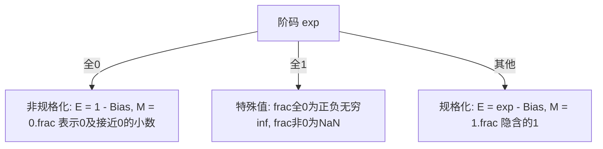

## 2.1 信息存储

计算机中一切信息都是**二进制位串**，大多数计算机以 8 位的**字节（byte）**作为最小可寻址的内存单位。机器级程序把内存视为一个非常大的字节数组，称为**虚拟内存（virtual memory）**；内存的每个字节由唯一的**地址（address）**标识，所有可能地址的集合就是**虚拟地址空间（virtual address space）**。

### 2.1.1 十六进制表示法

一个字节 8 位，用二进制太啰嗦、十进制转换麻烦，**十六进制（hexadecimal，base 16）**是事实标准：一个字节的取值 $00000000_2 \sim 11111111_2$ 即 $0x00 \sim 0xFF$。

| 十六进制 | 0 | 1 | 2 | 3 | 4 | 5 | 6 | 7 | 8 | 9 | A | B | C | D | E | F |
| --- | --- | --- | --- | --- | --- | --- | --- | --- | --- | --- | --- | --- | --- | --- | --- | --- |
| 十进制 | 0 | 1 | 2 | 3 | 4 | 5 | 6 | 7 | 8 | 9 | 10 | 11 | 12 | 13 | 14 | 15 |

0~9 与十进制完全相同，需要记的只有 A~F 六个。常用换算技巧：$2^n$ 的十六进制就是 $2^{n \bmod 4}$ 后面跟 $\lfloor n/4 \rfloor$ 个 0，如 $2^{11} = 2^3 \times 2^8 = 0x800$。十六进制 ↔ 二进制按 4 位一组直接映射。

### 2.1.2 字数据大小

**字长（word size）**指指针的标称大小（nominal size），虚拟地址以字长编码，它决定了最大虚拟地址空间：32 位字长限制虚拟地址空间为 4 GB；64 位字长为 16 EB（exabyte，$2^{64}$ 字节）。x86-64 机器上 `long` 为 8 字节，而 32 位机器为 4 字节。

C 的数据类型在 Linux/gcc 下 32 位与 64 位机器上的典型大小：

| C 声明 | 32 位 | 64 位 |
| --- | --- | --- |
| `char` | 1 | 1 |
| `short int` | 2 | 2 |
| `int` | 4 | 4 |
| `long int` | 4 | 8 |
| `long long int` | 8 | 8 |
| `char *` | 4 | 8 |
| `float` | 4 | 4 |
| `double` | 8 | 8 |

`int32_t`、`int64_t` 等定宽类型是 ISO C99 引入的，大小固定，利于可移植性。

### 2.1.3 寻址和字节顺序

多字节对象在内存中如何排列各字节？对 `int x = 0x01234567`、`&x = 0x100`：

| 地址 | 0x100 | 0x101 | 0x102 | 0x103 |
| --- | --- | --- | --- | --- |
| **小端（little endian）** | 67 | 45 | 23 | 01 |
| **大端（big endian）** | 01 | 23 | 45 | 67 |

- **小端法（little endian）**：最低有效字节在最前面（多数 Intel 兼容机）。
- **大端法（big endian）**：最高有效字节在最前面（多数 IBM、Oracle 机器；网络字节序也是大端）。

用一段程序打印对象的字节表示：

```c
#include <stdio.h>

typedef unsigned char *byte_pointer;

void show_bytes(byte_pointer start, size_t len) {
    size_t i;
    for (i = 0; i < len; i++)
        printf(" %.2x", start[i]);   // 以十六进制逐字节打印
    printf("\n");
}

void show_int(int x) {
    show_bytes((byte_pointer) &x, sizeof(int));
}
void show_float(float x) {
    show_bytes((byte_pointer) &x, sizeof(float));
}
void show_pointer(void *x) {
    show_bytes((byte_pointer) &x, sizeof(void *));
}
```

再用 `test_show_bytes` 把三种类型各验一遍（原书示例）：

```c
void test_show_bytes(int val) {
    int ival = val;
    float fval = (float) ival;
    int *pval = &ival;
    show_int(ival);
    show_float(fval);
    show_pointer(pval);
}
```

在 x86-64 Linux 上调用 `test_show_bytes(12345)`，三组输出依次是：

```text
 39 30 00 00                /* int   12345    = 0x00003039, 小端 */
 00 e4 40 46                /* float 12345.0  = 0x4640E400, 小端, 编码推导见 2.4.3 */
 28 e1 d5 21 47 55 00 00    /* &ival: 指针值随每次运行变化 */
```

- **int**：`39 30 00 00` 正是 0x00003039 的逆序——最低有效字节先存。
- **float**：12345.0 的编码是 0x4640E400（2.4.3 逐位推导），小端输出即其逆序 `00 e4 40 46`。同样是数值 12345，int 与 float 的字节完全不同——**字节含义取决于类型上下文**，正呼应 2.1 开头的主题。
- **指针**：`&ival` 是 8 字节地址，具体值随运行变化（地址空间布局随机化的缘故），但同样按小端排列。

在大端机器（如 Sun）上，同样数据的字节序正好相反：

| 值 | 类型 | 大端机器（如 Sun） | 小端机器（x86-64） |
| --- | --- | --- | --- |
| 12345 | int | 00 00 30 39 | 39 30 00 00 |
| 12345.0 | float | 46 40 e4 00 | 00 e4 40 46 |
| &ival | int * | （随运行变化） | （随运行变化） |

字符串是例外——`const char *s = "12345"; show_bytes((byte_pointer) s, strlen(s));` 在两种机器上都输出 `31 32 33 34 35`（'1'~'5' 的 ASCII），因为每个字符独立占一字节，与字节序无关（2.1.4 展开）。

同样的值在不同机器/系统上的字节序列可能不同，**这解释了二进制数据在网络传输与文件存储时必须约定字节序**。

### 2.1.4 表示字符串

C 字符串是以 null 字符（`'\0'`，值为 0）结尾的字节数组。ASCII 字符串的编码与字节序无关（每字符独立占一字节），因而在任何机器上文本数据具有更强的平台独立性。

### 2.1.5 表示代码

同一段 C 源码，不同机器/编译器产出的机器码不同——**机器码没有统一的标准二进制格式**。从这个角度看，程序也不过是字节序列。

### 2.1.6 布尔代数简介

二进制值 1/0 定义了布尔代数，基本运算：**NOT（¬）、AND（∧）、OR（∨）**。布尔运算可以按位扩展到向量：两个等长位向量按位独立运算。位向量的一个用途是表示有限集合：如 $a = [01101001]$ 表示集合 $\{0, 3, 5, 6\}$，`&` 求交集、`|` 求并集、`~` 求补集。

### 2.1.7 C 语言中的位级运算

C 支持 `&`（按位与）、`|`（按位或）、`^`（按位异或）、`~`（按位取反），直接映射到布尔运算。经典应用——**不借助临时变量交换两个值**：

```c
void inplace_swap(int *x, int *y) {
    *y = *x ^ *y;   /* 第 1 步: a ^ b 存入 y */
    *x = *x ^ *y;   /* 第 2 步: x 变为原 y */
    *y = *x ^ *y;   /* 第 3 步: y 变为原 x */
}
```

原理：`(a ^ b) ^ a = b`。注意 x 与 y 指向同一位置时结果会被清零。另一个经典是掩码（mask）：`x & 0xFF` 取出最低字节；`~0` 生成全 1 掩码。

### 2.1.8 C 语言中的逻辑运算

`||`、`&&`、`!` 与位级运算的区别：**把任何非零值视为真，只产生 0/1**，且**短路求值**：

```c
int a = 0x55, b = 0x39;
a && b   /* 1: 两者都非零 */
!a || !b /* 0: !a 为 0, !b 为 0 */
/* 对比位级: a & b = 0x11, a | b = 0x7D, ~a | ~b = 0xEE (= ~(a & b)) */
```

指针判空惯用法：`if (!p || *p > 0)`——若 p 为 NULL，短路避免了对空指针解引用。

### 2.1.9 C 语言中的移位运算

- 左移 `x << k`：左端丢弃，右端补 0。
- **右移**分两种：
  - **逻辑右移（logical）**：左端补 0。
  - **算术右移（arithmetic）**：左端补**最高有效位的值**（符号扩展）。
- **无符号数**的右移必然是逻辑右移；**有符号数**（补码）在几乎所有机器上都用算术右移。
- Java 中明确区分：`>>` 算术右移，`>>>` 逻辑右移。
- 移位量 k 应在 0 ~ w−1 之间；k ≥ w 时是未定义行为（C 标准未作规定），x86-64 硬件实际只取 k 的低 5 位（64 位移位取低 6 位），相当于对 32（或 64）取模——不能依赖这一行为。
- 移位运算优先级低于加法：`1 << 2 + 3 << 4` 实际是 `(1 << (2 + 3)) << 4`，**写移位表达式时加括号**。

## 2.2 整数表示

### 2.2.1 整型数据类型

w 位能表示 $2^w$ 个值。关键取值（w 位）：

| 量 | 值 |
| --- | --- |
| $UMax_w$ | $2^w - 1$ |
| $TMin_w$ | $-2^{w-1}$ |
| $TMax_w$ | $2^{w-1} - 1$ |

注意 **$|TMin| = TMax + 1$**（补码的不对称性）：一半的位模式表示负数，另一半表示非负数，而 0 占掉了非负数的一个名额。64 位下：`TMin = -9223372036854775808`，`TMax = 9223372036854775807`。

### 2.2.2 无符号数的编码

$$B2U_w(\vec{x}) = \sum_{i=0}^{w-1} x_i \cdot 2^i$$

无符号编码是**双射**——每个长度为 w 的位模式唯一对应一个 $0 \sim 2^w - 1$ 之间的值。

### 2.2.3 补码编码

**补码（two's complement）**：最高位是符号位，权重为 $-2^{w-1}$：

$$B2T_w(\vec{x}) = -x_{w-1} \cdot 2^{w-1} + \sum_{i=0}^{w-2} x_i \cdot 2^i$$

- 补码编码同样是双射。w = 4 时：`[1111]` = −1，`[0111]` = $TMax = 7$，`[1000]` = $TMin = -8$。
- 位模式视角：非负数 x 的补码位模式与它的无符号位模式相同；负数 $-x$ 的补码位模式与无符号值 $2^w - x$ 的位模式相同。
- **$UMax = 2 \times TMax + 1$**。

### 2.2.4 有符号数与无符号数之间的转换

C 标准要求：**位模式不变，解释方式改变**。补码 ↔ 无符号的映射：

$$T2U_w(x) = \begin{cases} x + 2^w, & x < 0 \\ x, & x \geq 0 \end{cases}$$

$$U2T_w(u) = \begin{cases} u, & u \leq TMax_w \\ u - 2^w, & u > TMax_w \end{cases}$$

例如 16 位下：12345 的两种表示相同；−1 ↔ 65535；−32768 ↔ 32768。

### 2.2.5 C 语言中的有符号数与无符号数

- C 中大多数常数默认是有符号的 int；`12345U` 后缀 U 表示无符号。
- **当一个运算对象是无符号数时，另一个会被隐式转换为无符号**——这是大量 bug 的来源：

```c
int a = -1;
unsigned b = 0;
if (a < b)                  /* -1 被转为 UMax, 比较结果为假! */
    printf("负数更小\n");
else
    printf("实际会走到这里\n"); /* 打印这个 */
```

- `sizeof` 返回无符号类型，经典坑：

```c
for (unsigned i = n - 1; i >= 0; i--)  /* i >= 0 对无符号数恒为真, 减到 0 再减 1 又回绕成 UMax, 死循环 */
    ...
```

### 2.2.6 扩展一个数字的位表示

- **无符号数 → 更宽类型：零扩展（zero extension）**，高位补 0。
- **补码数 → 更宽类型：符号扩展（sign extension）**，高位补符号位。例如 16 位 −1（`0xFFFF`）扩为 32 位 `0xFFFFFFFF`，仍是 −1。
- C 中大小与符号一起改变时（如 `short → unsigned`），先做符号扩展、再按无符号解释：`short sx = -12345; unsigned ux = sx;` 得到 32 位值 4294954951（`0xFFFFCFC7`），位模式与 −12345 的 32 位补码完全相同。

### 2.2.7 截断数字

截断到 k 位 = **对 $2^k$ 取模**：

- 无符号：$B2U_k([x_{k-1}, \dots, x_0]) = B2U_w(\vec{x}) \bmod 2^k$。
- 补码：先取模、再按补码解释，即 $U2T_k(B2U_w(\vec{x}) \bmod 2^k)$。

原书例子：int 值 53191（`0x0000CFC7`）截断为 short 时只保留低 16 位 `0xCFC7`，按补码解释为 −12345——$53191 \bmod 2^{16} = 53191$，$53191 - 65536 = -12345$。

### 2.2.8 关于有符号数与无符号数的建议

- 无符号运算的回绕（wrap around）并非 bug 而是**特性**，适合取模运算、以及想把全部 w 位模式都当作合法值使用的场合（如位向量）。
- **谨慎在可能为负的表达式场景使用无符号**：倒序循环 `for (unsigned i = n-1; i >= 0; i--)` 死循环；与 `sizeof` 的结果比较时也要注意。

## 2.3 整数运算

### 2.3.1 无符号加法

w 位无符号加法：**溢出则丢弃高位，等价于模 $2^w$ 运算**：

$$x +^u_w y = \begin{cases} x + y, & x + y < 2^w \quad \text{正常} \\ x + y - 2^w, & 2^w \leq x + y < 2^{w+1} \quad \text{溢出} \end{cases}$$

**检测溢出**：$s = x + y$ 溢出当且仅当 $s < x$（或等价地 $s < y$）。

### 2.3.2 补码加法

补码加法 = 按无符号加法算出位级结果，再解释为补码。三种情况：正溢出（$x + y$ 大于 $TMax$，结果"变负"）、正常、负溢出（$x + y$ 小于 $TMin$，结果"变正"）：

$$x +^t_w y = \begin{cases} x + y - 2^w, & 2^{w-1} \leq x + y \quad \text{正溢出} \\ x + y, & -2^{w-1} \leq x + y < 2^{w-1} \quad \text{正常} \\ x + y + 2^w, & x + y < -2^{w-1} \quad \text{负溢出} \end{cases}$$

例：8 位下 127 + 1 = −128（正溢出），−128 +（−1）= 127（负溢出）。

**检测补码加法溢出**：当且仅当 $x$、$y$ 同号，而和 $s$ 与它们异号。原书练习 2.30 的答案：

```c
/* Determine whether arguments can be added without overflow */
int tadd_ok(int x, int y) {
    int s = x + y;
    if (x > 0 && y > 0 && s < 0) return 0;  /* 正溢出: 两个正数相加变非正 */
    if (x < 0 && y < 0 && s >= 0) return 0; /* 负溢出: 两个负数相加变非负 */
    return 1;
}
```

### 2.3.3 补码的非

$TMin_w$ 的非是它自己（对 $-2^{w-1}$ 取负发生溢出，结果仍是 $-2^{w-1}$）；其余 x 的非就是 $-x$。位级技巧：**按位取反再加 1**，即 $-x = \sim x + 1$。

### 2.3.4 无符号乘法

w 位乘积可能需要 2w 位，机器只保留低 w 位：$x *^u_w y = (x \cdot y) \bmod 2^w$。

### 2.3.5 补码乘法

同样保留低 w 位、再按补码解释：$x *^t_w y = U2T_w((x \cdot y) \bmod 2^w)$。**关键结论：无符号乘与补码乘的位级结果完全相同**，只是解释不同。补码乘法的溢出检测没有加法那么便宜：可以在 $x \neq 0$ 时用 $p = x \times y$ 除以 $x$、与 $y$ 比较，不等则溢出——但这要付出一次除法的代价。

### 2.3.6 乘以常数

在多数机器上整数乘法要 3~13 个周期，编译器用**移位与加法/减法**组合来优化乘常数：

- 乘 $2^k$：左移 k 位即可。
- 乘任意常数 K：把 K 写成二进制，每个 1 对应一次"移位后相加"；对连续 1 的段还可以收拢成减法。以 $x \times 14$（14 = 1110₂）为例：
  - 加法展开：`(x<<3) + (x<<2) + (x<<1)`，即 8x + 4x + 2x；
  - 减法收拢：`(x<<4) - (x<<1)`，即 16x − 2x——连续 1 的段越长，减法形式越省。

### 2.3.7 除以 2 的幂

除法更慢（20~30+ 个周期），除以 2 的幂可用右移代替：

- **无符号数**：逻辑右移 k 位，结果恰为 $\lfloor x / 2^k \rfloor$，没有歧义。
- **补码数**：算术右移对负数**向下舍入（偏小）**，而 C 语言要求除法向零舍入。修正办法是**加偏置（biasing）再移位**：$(x + (1 << k) - 1) >> k$——负数先加 $2^k - 1$ 再算术右移，得到 $\lceil x / 2^k \rceil$，即向零舍入的结果。

### 2.3.8 关于整数运算的最后思考

- 计算机整数运算是**模运算**，"环绕"是正常行为，不是异常。
- 补码让加减乘的位级实现与无符号完全统一，是不依赖硬件细节的巧妙编码；不对称的 $TMin$ 则是多数边界问题的根源。
- **必须时刻意识到溢出可能发生**，检查它是程序员的责任。

## 2.4 浮点数

### 2.4.1 二进制小数

二进制小数按 2 的幂加权：小数点左边是 $2^0, 2^1, \dots$（非负幂），右边是 $2^{-1}, 2^{-2}, \dots$（负幂）。二进制小数只能精确表示 $x / 2^k$ 形式的数——像 1/3 = 0.0101⋯₂ 这样无限循环，**十进制小数（如 0.1）在二进制中无法精确表示**，这是一切浮点精度问题的根源。

### 2.4.2 IEEE 浮点表示

IEEE 754 标准用 $V = (-1)^s \times M \times 2^E$ 表示一个数：

- **符号（sign）** s：1 位，决定正负。
- **尾数（significand）** M：一个二进制小数，范围是 $1 \sim 2 - \varepsilon$ 或 $0 \sim 1 - \varepsilon$。
- **阶码（exponent）** E：对浮点数加权。

单精度（float，32 位）：s 占 1 位、exp 字段 8 位、frac 字段 23 位；双精度（double，64 位）：s 占 1 位、exp 11 位、frac 52 位。按 exp 字段的取值分三种情况（以单精度为例）：



- **偏置（bias）**：$Bias = 2^{k-1} - 1$（k 为 exp 的位数），单精度为 127、双精度为 1023。规格化数的阶码 $E = exp - Bias$，单精度 E 的取值范围是 −126 ~ +127。
- 规格化数**隐含了开头的 1**（leading one），白赚一位精度：M = 1.xxx。
- 非规格化数的两个用途：**表示 0**（exp、frac 全 0；有 +0.0 和 −0.0 之分），以及**渐进下溢**（表示非常接近 0 的数，平滑过渡到 0）。
- 特殊值：**+∞ / −∞**（如除零、溢出的结果）与 **NaN（Not a Number）**（如 $\sqrt{-1}$、∞ − ∞ 的结果）。

### 2.4.3 数字示例

先看原书的核心例子：**12345 的浮点编码**。12345 = 0x3039 = $11000000111001_2$，规格化为 $1.1000000111001_2 \times 2^{13}$，于是：

- E = 13 → exp = E + Bias = 13 + 127 = 140 = $10001100_2$；
- frac = 1000000111001 去掉隐含的 1 后、右侧补 0 到 23 位；
- 拼起来：`0 10001100 10000001110010000000000`，写成十六进制是 **0x4640E400**——同一个数 12345，按 float 编码后的位模式。

再核对几个特殊位模式（单精度）：

| 位模式 | 表示 |
| --- | --- |
| `0 00000000 00000000000000000000000` | +0 |
| `0 11111111 00000000000000000000000` | +∞ |
| `0 11111111 10000000000000000000000` | NaN |
| `0 01111111 00000000000000000000000` | 1.0（E = 0，M = 1.0） |

浮点数的分布不均匀：**越靠近 0 越稠密，绝对值越大越稀疏**。

### 2.4.4 舍入

默认方式是**向偶数舍入（round-to-even）**：把数舍入到最接近的候选值；恰好在两候选正中间时，向最低有效位为偶数的那一方舍——十进制里是最低位数字为偶数（0、2、4、6、8），二进制里是最低有效位为 0。

> Round-to-even rounding rounds a number to the nearest value, with the convention that halfway cases are rounded to the nearest even digit.
>
> 向偶数舍入把数舍入到最接近的值，约定恰在中间的情形舍入到最接近的偶数。

- 十进制例子：1.40 → 1.4，1.60 → 1.6，而 1.5 与 2.5 都 → 2（中间值向偶）。
- 好处：**无统计偏置**——中间值一半向上、一半向下，长期平均更接近真值。二进制同理：中间值舍入到最低有效位为 0 的候选。

其他舍入模式：向零舍入、向下舍入、向上舍入。

### 2.4.5 浮点运算

- 浮点加法**可交换但不可结合**：用 float 计算时 $(3.14 + 10^{10}) - 10^{10}$ 得 0.0（3.14 在与 $10^{10}$ 相加时被舍掉了），而 $3.14 + (10^{10} - 10^{10})$ 得 3.14。
- 浮点乘法对加法**不满足分配律**。
- 单调性（monotonicity）成立：若 $a \geq b$，则 $a + c \geq b + c$（NaN 除外）。这一点比补码的环绕行为"安全"：浮点溢出到 ∞、无效运算得 NaN，都能被检测出来；整数溢出则无声无息地回绕。
- 缺乏结合性也意味着**编译器不能随意重排浮点表达式**，很多数学恒等式在浮点运算中不再成立。

### 2.4.6 C 语言中的浮点数

C 提供 `float` 和 `double`：标准只保证 float 至少能精确表示 6 位十进制有效数字、double 至少 10 位（IEEE 实现下尾数字段 23/52 位，加隐含位共 24/53 位有效，约合 7 位与 16 位十进制精度）。类型转换：`int → float` 数值可能改变（32 位 int 超过 24 位有效尾数，需要舍入）；`float → int` 向零舍入，结果越界或为 NaN 时未定义（多数机器给 $TMin$）。

## 2.5 小结

- 计算机把信息编码为位，含义取决于上下文；无符号与补码共享位模式，差别只在解释。
- 隐式转换规则（有符号数遇无符号数）是 bug 高发区；整数运算是模运算，溢出回绕；$TMin$ 的不对称性值得警惕。
- IEEE 754 以规格化/非规格化数覆盖极宽的动态范围，向偶舍入无统计偏置，代价是牺牲了结合律。
- 精确理解这些表示，是写出正确、安全、可移植代码的前提。
